# swcollect data model

Generated by `swcollect erd` from the database (instance `demo/127.0.0.1:17776`, flow run 43). Do not edit: run it again.

## sw_core (canonical entities, real foreign keys)

```mermaid
erDiagram
    device ||--o{ cdp_neighbor : "device_id"
    ncm_node ||--o{ config_version : "ncm_node_id"
    custom_poller ||--o{ custom_poller_assignment : "custom_poller_id"
    device ||--o{ custom_poller_assignment : "device_id"
    interface ||--o{ custom_poller_assignment : "interface_id (not enforced)"
    ncm_node ||--o{ hardware_component : "ncm_node_id"
    device ||--o{ hardware_sensor : "device_id"
    device ||--o{ interface : "device_id"
    subnet ||--o{ ip_address : "subnet_id"
    device ||--o{ lag_member : "device_id"
    device ||--o{ link : "dest_device_id"
    interface ||--o{ link : "dest_interface_id"
    device ||--o{ link : "src_device_id"
    interface ||--o{ link : "src_interface_id"
    device ||--o{ lldp_neighbor : "device_id"
    device ||--o{ ncm_node : "device_id"
    device ||--o{ node_ip_address : "device_id"
    device ||--o{ routing_neighbor : "device_id"
    device ||--o{ vlan : "device_id"
    device ||--o{ vrf : "device_id"
    alert_active {
        bigint id
        text stable_id
        integer instance_id
        bigint AlertActiveID
        integer AlertObjectID
        timestamp_without_time_zone TriggeredDateTime
        text TriggeredMessage
        boolean Acknowledged
        text AcknowledgedBy
        timestamp_without_time_zone AcknowledgedDateTime
        text raw_table
        bigint run_id
        timestamp_with_time_zone deleted_at
    }
    cdp_neighbor {
        bigint id
        text stable_id
        integer instance_id
        integer NodeID
        integer LocalPort
        text RemoteSystemName
        text RemotePort
        text RemoteIP
        bigint device_id
        text raw_table
        bigint run_id
        timestamp_with_time_zone deleted_at
    }
    config_version {
        bigint id
        text stable_id
        integer instance_id
        uuid ConfigID
        uuid NcmNodeID
        timestamp_without_time_zone DownloadTime
        text ConfigType
        text ConfigTitle
        boolean Baseline
        boolean IsBinary
        timestamp_without_time_zone ModifiedTime
        bigint ncm_node_id
        text raw_table
        bigint run_id
        timestamp_with_time_zone deleted_at
    }
    custom_poller {
        bigint id
        text stable_id
        integer instance_id
        uuid CustomPollerID
        text UniqueName
        text OID
        text MIB
        text Description
        text SNMPGetType
        text Unit
        text raw_table
        bigint run_id
        timestamp_with_time_zone deleted_at
    }
    custom_poller_assignment {
        bigint id
        text stable_id
        integer instance_id
        uuid CustomPollerAssignmentID
        uuid CustomPollerID
        integer NodeID
        integer InterfaceID
        text AssignmentName
        bigint custom_poller_id
        bigint device_id
        bigint interface_id
        text raw_table
        bigint run_id
        timestamp_with_time_zone deleted_at
    }
    device {
        bigint id
        text stable_id
        integer instance_id
        integer NodeID
        text Caption
        text IPAddress
        text Vendor
        text MachineType
        text SoftwareVersion
        text IOSImage
        integer Status
        text ObjectSubType
        text SysName
        text SysObjectID
        text Location
        text Contact
        integer EngineID
        timestamp_without_time_zone LastBoot
        double_precision SystemUpTime
        timestamp_without_time_zone LastSync
        integer MinutesSinceLastSync
        text raw_table
        bigint run_id
        timestamp_with_time_zone deleted_at
    }
    hardware_component {
        bigint id
        text stable_id
        integer instance_id
        uuid NcmNodeID
        integer EntPhysicalIndex
        text EntityClass
        text EntityName
        text EntityDescription
        text Serial
        text Model
        text Manufacturer
        text HardwareRevision
        text FirmwareRevision
        text SoftwareRevision
        bigint ncm_node_id
        text raw_table
        bigint run_id
        timestamp_with_time_zone deleted_at
    }
    hardware_sensor {
        bigint id
        text stable_id
        integer instance_id
        integer NodeID
        text UniqueName
        text Name
        integer Status
        integer HardwareCategoryStatusID
        double_precision Value
        text Unit
        boolean IsDisabled
        boolean IsDeleted
        bigint device_id
        text raw_table
        bigint run_id
        timestamp_with_time_zone deleted_at
    }
    interface {
        bigint id
        text stable_id
        integer instance_id
        integer InterfaceID
        integer NodeID
        text Name
        text Alias
        integer Type
        double_precision Speed
        smallint AdminStatus
        smallint OperStatus
        integer MTU
        text IfName
        integer Index
        text PhysicalAddress
        timestamp_without_time_zone LastChange
        text NameNormalized
        bigint device_id
        text raw_table
        bigint run_id
        timestamp_with_time_zone deleted_at
    }
    ip_address {
        bigint id
        text stable_id
        integer instance_id
        bigint IpNodeId
        integer SubnetId
        text IPAddress
        smallint Status
        text MAC
        text DnsBackward
        text SysName
        text Vendor
        timestamp_without_time_zone LastSync
        text Comments
        bigint subnet_id
        text raw_table
        bigint run_id
        timestamp_with_time_zone deleted_at
    }
    lag_member {
        bigint id
        text stable_id
        integer instance_id
        integer NodeID
        integer ParentInterfaceIndex
        integer ChildInterfaceIndex
        integer RelationshipTypeID
        smallint LACPOperState
        smallint LACPAdminState
        bigint device_id
        text raw_table
        bigint run_id
        timestamp_with_time_zone deleted_at
    }
    link {
        bigint id
        text stable_id
        integer instance_id
        integer SrcNodeID
        integer SrcInterfaceID
        integer DestNodeID
        integer DestInterfaceID
        text SrcType
        text DestType
        text LayerType
        integer DataSourceNodeID
        timestamp_without_time_zone LastUpdateUtc
        bigint src_device_id
        bigint dest_device_id
        bigint src_interface_id
        bigint dest_interface_id
        text raw_table
        bigint run_id
        timestamp_with_time_zone deleted_at
    }
    lldp_neighbor {
        bigint id
        text stable_id
        integer instance_id
        integer NodeID
        integer LocalPort
        text RemoteSystemName
        text RemotePort
        text RemotePortDescription
        text RemoteIP
        bigint device_id
        text raw_table
        bigint run_id
        timestamp_with_time_zone deleted_at
    }
    ncm_node {
        bigint id
        text stable_id
        integer instance_id
        uuid NcmNodeID
        integer CoreNodeID
        text NodeCaption
        text ConnectionProfile
        bigint device_id
        text raw_table
        bigint run_id
        timestamp_with_time_zone deleted_at
    }
    node_ip_address {
        bigint id
        text stable_id
        integer instance_id
        integer NodeID
        text IPAddress
        text IPAddressType
        integer InterfaceIndex
        text SubnetMask
        bigint device_id
        text raw_table
        bigint run_id
        timestamp_with_time_zone deleted_at
    }
    routing_neighbor {
        bigint id
        text stable_id
        integer instance_id
        integer NeighborID
        integer NodeID
        text NeighborIP
        integer ProtocolID
        integer ProtocolStatus
        integer AutonomousSystem
        timestamp_without_time_zone LastChange
        boolean IsDeleted
        integer LocalProtocolInterfaceIndex
        text LocalProtocolInterfaceIp
        bigint device_id
        text raw_table
        bigint run_id
        timestamp_with_time_zone deleted_at
    }
    subnet {
        bigint id
        text stable_id
        integer instance_id
        integer SubnetId
        text Address
        integer CIDR
        text FriendlyName
        integer ParentId
        text VLAN
        text Location
        bigint UsedCount
        bigint AvailableCount
        numeric PercentUsed
        smallint Status
        timestamp_without_time_zone LastDiscovery
        text raw_table
        bigint run_id
        timestamp_with_time_zone deleted_at
    }
    vlan {
        bigint id
        text stable_id
        integer instance_id
        integer NodeID
        integer VlanId
        text VlanName
        integer VlanIfIndex
        integer VlanStatus
        timestamp_without_time_zone LastSyncUtc
        bigint device_id
        text raw_table
        bigint run_id
        timestamp_with_time_zone deleted_at
    }
    vrf {
        bigint id
        text stable_id
        integer instance_id
        integer NodeID
        integer VrfIndex
        text Name
        text RouteDistinguisher
        integer Status
        bigint device_id
        text raw_table
        bigint run_id
        timestamp_with_time_zone deleted_at
    }
```

## Flows (sw_raw → sw_core), in order

| # | source | target | rule | in | out | dead-letter |
|---|---|---|---|---|---|---|
| 1 | sw_raw.orion_nodes | sw_core.device | id ['NodeID'] | 40 | 40 | 0 |
| 2 | sw_raw.ipam_subnet | sw_core.subnet | id ['SubnetId'] | 7 | 7 | 0 |
| 3 | sw_raw.orion_npm_custompollers | sw_core.custom_poller | id ['CustomPollerID'] | 3 | 3 | 0 |
| 4 | sw_raw.orion_alertactive | sw_core.alert_active | id ['AlertActiveID'] | 4 | 4 | 0 |
| 5 | sw_raw.ncm_nodes | sw_core.ncm_node | id ['NcmNodeID']; device_id → device | 36 | 36 | 0 |
| 6 | sw_raw.orion_npm_interfaces | sw_core.interface | id ['InterfaceID']; device_id → device | 372 | 372 | 0 |
| 7 | sw_raw.orion_nodelldpentry | sw_core.lldp_neighbor | id ['NodeID', 'LocalPort', 'RemoteSystemName', 'RemotePort']; device_id → device | 148 | 148 | 0 |
| 8 | sw_raw.orion_nodecdpentry | sw_core.cdp_neighbor | id ['NodeID', 'LocalPort', 'RemoteSystemName', 'RemotePort']; device_id → device | 12 | 12 | 0 |
| 9 | sw_raw.orion_nodeipaddresses | sw_core.node_ip_address | id ['NodeID', 'IPAddress']; device_id → device | 191 | 191 | 0 |
| 10 | sw_raw.orion_nodevlans | sw_core.vlan | id ['NodeID', 'VlanId']; device_id → device | 42 | 42 | 0 |
| 11 | sw_raw.orion_routing_vrf | sw_core.vrf | id ['NodeID', 'VrfIndex']; device_id → device | 24 | 24 | 0 |
| 12 | sw_raw.orion_npm_interfacesrelationship | sw_core.lag_member | id ['NodeID', 'ParentInterfaceIndex', 'ChildInterfaceIndex']; device_id → device | 24 | 24 | 0 |
| 13 | sw_raw.orion_routing_neighbors | sw_core.routing_neighbor | id ['NeighborID']; device_id → device | 165 | 165 | 0 |
| 14 | sw_raw.orion_hardwarehealth_hardwareitem | sw_core.hardware_sensor | id ['NodeID', 'UniqueName']; device_id → device | 104 | 104 | 0 |
| 15 | sw_raw.ipam_ipnode | sw_core.ip_address | id ['IpNodeId']; subnet_id → subnet | 190 | 190 | 0 |
| 16 | sw_raw.orion_topologyconnections | sw_core.link | id ['SrcNodeID', 'SrcInterfaceID', 'DestNodeID', 'DestInterfaceID']; src_device_id → device; dest_device_id → device; src_interface_id → interface; dest_interface_id → interface | 149 | 148 | 1 |
| 17 | sw_raw.ncm_entityphysical | sw_core.hardware_component | id ['NcmNodeID', 'EntPhysicalIndex']; ncm_node_id → ncm_node | 216 | 216 | 0 |
| 18 | sw_raw.ncm_configarchive | sw_core.config_version | id ['ConfigID']; ncm_node_id → ncm_node | 144 | 144 | 0 |
| 19 | sw_raw.orion_npm_custompollerassignment | sw_core.custom_poller_assignment | id ['CustomPollerAssignmentID']; custom_poller_id → custom_poller; device_id → device; interface_id → interface (not enforced) | 12 | 12 | 0 |

## Relationships between SWIS entities (sw_meta.relationship)

Only `proven` relationships get a `sw_rel` view and can back a foreign key.

| source | name | target | columns | origin | method | status | view | stored vs SWIS |
|---|---|---|---|---|---|---|---|---|
| Cirrus.ArpTables | InterfaceID:Interfaces | Cirrus.Interfaces | InterfaceID=InterfaceID | name_match | values | proven | sw_rel.cirrus_arptables__interfaceid_interfaces | consistent |
| Cirrus.ArpTables | NodeID:Nodes | Cirrus.Nodes | NodeID=NodeID | name_match | values | proven | sw_rel.cirrus_arptables__nodeid_nodes | consistent |
| Cirrus.BridgePorts | NodeID:Nodes | Cirrus.Nodes | NodeID=NodeID | name_match | values | proven | sw_rel.cirrus_bridgeports__nodeid_nodes | consistent |
| Cirrus.CacheDiffResults | NodeID:Nodes | Cirrus.Nodes | NodeID=NodeID | name_match | values | proven | sw_rel.cirrus_cachediffresults__nodeid_nodes | consistent |
| Cirrus.CiscoCards | NodeID:Nodes | Cirrus.Nodes | NodeID=NodeID | name_match | values | proven | sw_rel.cirrus_ciscocards__nodeid_nodes | consistent |
| Cirrus.CiscoCdp | NodeID:Nodes | Cirrus.Nodes | NodeID=NodeID | name_match | values | proven | sw_rel.cirrus_ciscocdp__nodeid_nodes | consistent |
| Cirrus.CiscoChassis | NodeID:Nodes | Cirrus.Nodes | NodeID=NodeID | name_match | values | proven | sw_rel.cirrus_ciscochassis__nodeid_nodes | consistent |
| Cirrus.CiscoFlash | NodeID:Nodes | Cirrus.Nodes | NodeID=NodeID | name_match | values | proven | sw_rel.cirrus_ciscoflash__nodeid_nodes | consistent |
| Cirrus.CiscoFlashFiles | NodeID:Nodes | Cirrus.Nodes | NodeID=NodeID | name_match | values | proven | sw_rel.cirrus_ciscoflashfiles__nodeid_nodes | consistent |
| Cirrus.CiscoImageMIB | NodeID:Nodes | Cirrus.Nodes | NodeID=NodeID | name_match | values | proven | sw_rel.cirrus_ciscoimagemib__nodeid_nodes | consistent |
| Cirrus.CiscoMemoryPools | NodeID:Nodes | Cirrus.Nodes | NodeID=NodeID | name_match | values | proven | sw_rel.cirrus_ciscomemorypools__nodeid_nodes | consistent |
| Cirrus.ConfigArchive | NodeID:Nodes | Cirrus.Nodes | NodeID=NodeID | name_match | values | proven | sw_rel.cirrus_configarchive__nodeid_nodes | consistent |
| Cirrus.EntityLogical | NodeID:Nodes | Cirrus.Nodes | NodeID=NodeID | name_match | values | proven | sw_rel.cirrus_entitylogical__nodeid_nodes | consistent |
| Cirrus.EntityPhysical | NodeID:Nodes | Cirrus.Nodes | NodeID=NodeID | name_match | values | proven | sw_rel.cirrus_entityphysical__nodeid_nodes | consistent |
| Cirrus.Interfaces | InterfaceID:Interfaces | NCM.Interfaces | InterfaceID=InterfaceID | name_match | values | proven | sw_rel.cirrus_interfaces__interfaceid_interfaces | consistent |
| Cirrus.Interfaces | NodeID:Nodes | Cirrus.Nodes | NodeID=NodeID | name_match | values | proven | sw_rel.cirrus_interfaces__nodeid_nodes | consistent |
| Cirrus.IpAddresses | InterfaceID:Interfaces | Cirrus.Interfaces | InterfaceID=InterfaceID | name_match | values | proven | sw_rel.cirrus_ipaddresses__interfaceid_interfaces | consistent |
| Cirrus.IpAddresses | NodeID:Nodes | Cirrus.Nodes | NodeID=NodeID | name_match | values | proven | sw_rel.cirrus_ipaddresses__nodeid_nodes | consistent |
| Cirrus.LatestComparisonResults | NodeID:Nodes | Cirrus.Nodes | NodeID=NodeID | name_match | values | proven | sw_rel.cirrus_latestcomparisonresults__nodeid_nodes | consistent |
| Cirrus.MacForwarding | NodeID:Nodes | Cirrus.Nodes | NodeID=NodeID | name_match | values | proven | sw_rel.cirrus_macforwarding__nodeid_nodes | consistent |
| Cirrus.NCMNodeLicenseStatus | NodeID:Nodes | Orion.Nodes | NodeID=NodeID | name_match | values | proven | sw_rel.cirrus_ncmnodelicensestatus__nodeid_nodes | consistent |
| Cirrus.NCM_EosMatchQueue | NodeID:Nodes | Cirrus.Nodes | NodeID=NodeID | name_match | values | proven | sw_rel.cirrus_ncm_eosmatchqueue__nodeid_nodes | consistent |
| Cirrus.NodeProperties | NodeID:Nodes | Cirrus.Nodes | NodeID=NodeID | name_match | values | proven | sw_rel.cirrus_nodeproperties__nodeid_nodes | consistent |
| Cirrus.Nodes | NodeID:Nodes | NCM.Nodes | NodeID=NodeID | name_match | values | proven | sw_rel.cirrus_nodes__nodeid_nodes | consistent |
| Cirrus.PolicyAssignment | PolicyReportID:PolicyReports | Cirrus.PolicyReports | PolicyReportID=PolicyReportID | name_match | values | proven | sw_rel.cirrus_policyassignment__policyreportid_policyreports | consistent |
| Cirrus.PolicyCacheResults | NodeID:Nodes | Cirrus.Nodes | NodeID=NodeID | name_match | values | proven | sw_rel.cirrus_policycacheresults__nodeid_nodes | consistent |
| Cirrus.PolicyRuleAssignment | PolicyRuleID:PolicyRules | Cirrus.PolicyRules | PolicyRuleID=PolicyRuleID | name_match | values | proven | sw_rel.cirrus_policyruleassignment__policyruleid_policyrules | consistent |
| Cirrus.PortsTcp | NodeID:Nodes | Cirrus.Nodes | NodeID=NodeID | name_match | values | proven | sw_rel.cirrus_portstcp__nodeid_nodes | consistent |
| Cirrus.PortsUdp | NodeID:Nodes | Cirrus.Nodes | NodeID=NodeID | name_match | values | proven | sw_rel.cirrus_portsudp__nodeid_nodes | consistent |
| Cirrus.RouteTable | InterfaceID:Interfaces | Cirrus.Interfaces | InterfaceID=InterfaceID | name_match | values | proven | sw_rel.cirrus_routetable__interfaceid_interfaces | consistent |
| Cirrus.RouteTable | NodeID:Nodes | Cirrus.Nodes | NodeID=NodeID | name_match | values | proven | sw_rel.cirrus_routetable__nodeid_nodes | consistent |
| Cirrus.VLANs | NodeID:Nodes | Cirrus.Nodes | NodeID=NodeID | name_match | values | proven | sw_rel.cirrus_vlans__nodeid_nodes | consistent |
| Cirrus.VLANs | VLANID:VLANs | NCM.VLANs | VLANID=VLANID | name_match | values | proven | sw_rel.cirrus_vlans__vlanid_vlans | consistent |
| IPAM.IPConflict | AccountID:Accounts | Orion.Accounts | AccountID=AccountID | name_match | values | proven | sw_rel.ipam_ipconflict__accountid_accounts | consistent |
| IPAM.IPConflict | IPNodeId:IPNode | IPAM.IPNode | IPNodeId=IpNodeId | name_match | values | proven | sw_rel.ipam_ipconflict__ipnodeid_ipnode | consistent |
| IPAM.IPNode | SubnetId:Subnet | IPAM.Subnet | SubnetId=SubnetId | name_match | values | proven | sw_rel.ipam_ipnode__subnetid_subnet | consistent |
| NCM.ArpTables | InterfaceID:Interfaces | NCM.Interfaces | InterfaceID=InterfaceID | name_match | values | proven | sw_rel.ncm_arptables__interfaceid_interfaces | consistent |
| NCM.ArpTables | NodeID:Nodes | NCM.Nodes | NodeID=NodeID | name_match | values | proven | sw_rel.ncm_arptables__nodeid_nodes | consistent |
| NCM.BaselineNodeMap | NodeId:Nodes | NCM.Nodes | NodeId=NodeID | name_match | values | proven | sw_rel.ncm_baselinenodemap__nodeid_nodes | consistent |
| NCM.BaselineViolations | NodeId:Nodes | NCM.Nodes | NodeId=NodeID | name_match | values | proven | sw_rel.ncm_baselineviolations__nodeid_nodes | consistent |
| NCM.BridgePorts | NodeID:Nodes | NCM.Nodes | NodeID=NodeID | name_match | values | proven | sw_rel.ncm_bridgeports__nodeid_nodes | consistent |
| NCM.CiscoBootloadImages | NodeID:Nodes | NCM.Nodes | NodeID=NodeID | name_match | values | proven | sw_rel.ncm_ciscobootloadimages__nodeid_nodes | consistent |
| NCM.CiscoCards | NodeID:Nodes | NCM.Nodes | NodeID=NodeID | name_match | values | proven | sw_rel.ncm_ciscocards__nodeid_nodes | consistent |
| NCM.CiscoCdp | NodeID:Nodes | NCM.Nodes | NodeID=NodeID | name_match | values | proven | sw_rel.ncm_ciscocdp__nodeid_nodes | consistent |
| NCM.CiscoChassis | NodeID:Nodes | NCM.Nodes | NodeID=NodeID | name_match | values | proven | sw_rel.ncm_ciscochassis__nodeid_nodes | consistent |
| NCM.CiscoFlash | NodeID:Nodes | NCM.Nodes | NodeID=NodeID | name_match | values | proven | sw_rel.ncm_ciscoflash__nodeid_nodes | consistent |
| NCM.CiscoFlashFiles | NodeID:Nodes | NCM.Nodes | NodeID=NodeID | name_match | values | proven | sw_rel.ncm_ciscoflashfiles__nodeid_nodes | consistent |
| NCM.CiscoFruFanTrayStatus | NodeID:Nodes | NCM.Nodes | NodeID=NodeID | name_match | values | proven | sw_rel.ncm_ciscofrufantraystatus__nodeid_nodes | consistent |
| NCM.CiscoFruPowerStatus | NodeID:Nodes | NCM.Nodes | NodeID=NodeID | name_match | values | proven | sw_rel.ncm_ciscofrupowerstatus__nodeid_nodes | consistent |
| NCM.CiscoFruPowerSupplyGroups | NodeID:Nodes | NCM.Nodes | NodeID=NodeID | name_match | values | proven | sw_rel.ncm_ciscofrupowersupplygroups__nodeid_nodes | consistent |
| NCM.CiscoImageMIB | NodeID:Nodes | NCM.Nodes | NodeID=NodeID | name_match | values | proven | sw_rel.ncm_ciscoimagemib__nodeid_nodes | consistent |
| NCM.CiscoMemoryPools | NodeID:Nodes | NCM.Nodes | NodeID=NodeID | name_match | values | proven | sw_rel.ncm_ciscomemorypools__nodeid_nodes | consistent |
| NCM.ConfigArchive | Node | NCM.Nodes | NodeID=NodeID | navigation | navigation | proven | sw_rel.ncm_configarchive__node | match |
| NCM.ConfigBackupStatistic | NodeID:Nodes | NCM.Nodes | NodeID=NodeID | name_match | values | proven | sw_rel.ncm_configbackupstatistic__nodeid_nodes | consistent |
| NCM.ConfigBackupStatus | NodeID:Nodes | NCM.Nodes | NodeID=NodeID | name_match | values | proven | sw_rel.ncm_configbackupstatus__nodeid_nodes | consistent |
| NCM.ConfigInterfaceIpAddress | InterfaceID:Interfaces | Orion.NPM.Interfaces | InterfaceID=InterfaceID | name_match | values | proven | sw_rel.ncm_configinterfaceipaddress__interfaceid_interfaces | consistent |
| NCM.EntityLogical | NodeID:Nodes | NCM.Nodes | NodeID=NodeID | name_match | values | proven | sw_rel.ncm_entitylogical__nodeid_nodes | consistent |
| NCM.EntityPhysical | NodeID:Nodes | NCM.Nodes | NodeID=NodeID | name_match | values | proven | sw_rel.ncm_entityphysical__nodeid_nodes | consistent |
| NCM.EntityPhysicalJuniper | NodeID:Nodes | NCM.Nodes | NodeID=NodeID | name_match | values | proven | sw_rel.ncm_entityphysicaljuniper__nodeid_nodes | consistent |
| NCM.Interfaces | InterfaceID:Interfaces | Cirrus.Interfaces | InterfaceID=InterfaceID | name_match | values | proven | sw_rel.ncm_interfaces__interfaceid_interfaces | consistent |
| NCM.Interfaces | NodeID:Nodes | NCM.Nodes | NodeID=NodeID | name_match | values | proven | sw_rel.ncm_interfaces__nodeid_nodes | consistent |
| NCM.InventoryStatistic | NodeID:Nodes | NCM.Nodes | NodeID=NodeID | name_match | values | proven | sw_rel.ncm_inventorystatistic__nodeid_nodes | consistent |
| NCM.IpAddresses | InterfaceID:Interfaces | NCM.Interfaces | InterfaceID=InterfaceID | name_match | values | proven | sw_rel.ncm_ipaddresses__interfaceid_interfaces | consistent |
| NCM.IpAddresses | NodeID:Nodes | NCM.Nodes | NodeID=NodeID | name_match | values | proven | sw_rel.ncm_ipaddresses__nodeid_nodes | consistent |
| NCM.LatestTransferJobStatus | NodeID:Nodes | NCM.Nodes | NodeID=NodeID | name_match | values | proven | sw_rel.ncm_latesttransferjobstatus__nodeid_nodes | consistent |
| NCM.MacForwarding | NodeID:Nodes | NCM.Nodes | NodeID=NodeID | name_match | values | proven | sw_rel.ncm_macforwarding__nodeid_nodes | consistent |
| NCM.NodeProperties | NodeID:Nodes | NCM.Nodes | NodeID=NodeID | name_match | values | proven | sw_rel.ncm_nodeproperties__nodeid_nodes | consistent |
| NCM.Nodes | NodeID:Nodes | Cirrus.Nodes | NodeID=NodeID | name_match | values | proven | sw_rel.ncm_nodes__nodeid_nodes | consistent |
| NCM.Nodes | OrionNode | Orion.Nodes | CoreNodeID=NodeID | navigation | navigation | proven | sw_rel.ncm_nodes__orionnode | match |
| NCM.PortsTcp | NodeID:Nodes | NCM.Nodes | NodeID=NodeID | name_match | values | proven | sw_rel.ncm_portstcp__nodeid_nodes | consistent |
| NCM.PortsUdp | NodeID:Nodes | NCM.Nodes | NodeID=NodeID | name_match | values | proven | sw_rel.ncm_portsudp__nodeid_nodes | consistent |
| NCM.RTNAudit | NodeID:Nodes | NCM.Nodes | NodeID=NodeID | name_match | values | proven | sw_rel.ncm_rtnaudit__nodeid_nodes | consistent |
| NCM.RouteTable | InterfaceID:Interfaces | NCM.Interfaces | InterfaceID=InterfaceID | name_match | values | proven | sw_rel.ncm_routetable__interfaceid_interfaces | consistent |
| NCM.RouteTable | NodeID:Nodes | NCM.Nodes | NodeID=NodeID | name_match | values | proven | sw_rel.ncm_routetable__nodeid_nodes | consistent |
| NCM.TransferResults | NodeID:Nodes | NCM.Nodes | NodeID=NodeID | name_match | values | proven | sw_rel.ncm_transferresults__nodeid_nodes | consistent |
| NCM.VLANs | NodeID:Nodes | NCM.Nodes | NodeID=NodeID | name_match | values | proven | sw_rel.ncm_vlans__nodeid_nodes | consistent |
| NCM.VLANs | VLANID:VLANs | Cirrus.VLANs | VLANID=VLANID | name_match | values | proven | sw_rel.ncm_vlans__vlanid_vlans | consistent |
| Orion.AlertActive | AlertObject | Orion.AlertObjects | AlertObjectID=AlertObjectID | navigation | navigation | proven | sw_rel.orion_alertactive__alertobject | match |
| Orion.AlertHistory | AlertObjectID:AlertObjects | Orion.AlertObjects | AlertObjectID=AlertObjectID | name_match | values | proven | — | — |
| Orion.AlertObjects | RelatedNode | Orion.Nodes | RelatedNodeId=NodeID | override | values | proven | sw_rel.orion_alertobjects__relatednode | consistent |
| Orion.CPULoad | NodeID:Nodes | Orion.Nodes | NodeID=NodeID | name_match | values | proven | sw_rel.orion_cpuload__nodeid_nodes | consistent |
| Orion.HardwareHealth.HardwareInfo | NodeID:Nodes | Orion.Nodes | NodeID=NodeID | name_match | values | proven | sw_rel.orion_hardwarehealth_hardwareinfo__nodeid_nodes | consistent |
| Orion.HardwareHealth.HardwareItem | NodeID:Nodes | Orion.Nodes | NodeID=NodeID | name_match | values | proven | sw_rel.orion_hardwarehealth_hardwareitem__nodeid_nodes | consistent |
| Orion.NPM.CustomPollerAssignment | CustomPollerID:CustomPollers | Orion.NPM.CustomPollers | CustomPollerID=CustomPollerID | name_match | values | proven | sw_rel.orion_npm_custompollerassignment__custompollerid_custompollers | consistent |
| Orion.NPM.CustomPollerAssignment | NodeID:Nodes | Orion.Nodes | NodeID=NodeID | name_match | values | proven | sw_rel.orion_npm_custompollerassignment__nodeid_nodes | consistent |
| Orion.NPM.CustomPollerStatistics | CustomPollerAssignmentID:CustomPollerAssignment | Orion.NPM.CustomPollerAssignment | CustomPollerAssignmentID=CustomPollerAssignmentID | name_match | values | proven | sw_rel.orion_npm_custompollerstatistics__custompollerassignme_f5197b5b | consistent |
| Orion.NPM.CustomPollerStatus | CustomPollerAssignmentID:CustomPollerAssignment | Orion.NPM.CustomPollerAssignment | CustomPollerAssignmentID=CustomPollerAssignmentID | name_match | values | proven | sw_rel.orion_npm_custompollerstatus__custompollerassignmentid_705258ac | consistent |
| Orion.NPM.CustomPollerStatusOnNode | CustomPollerAssignmentID:CustomPollerAssignment | Orion.NPM.CustomPollerAssignment | CustomPollerAssignmentID=CustomPollerAssignmentID | name_match | values | proven | sw_rel.orion_npm_custompollerstatusonnode__custompollerassign_ea94436d | consistent |
| Orion.NPM.CustomPollerStatusOnNode | CustomPollerID:CustomPollers | Orion.NPM.CustomPollers | CustomPollerID=CustomPollerID | name_match | values | proven | sw_rel.orion_npm_custompollerstatusonnode__custompollerid_cus_d6e26cd9 | consistent |
| Orion.NPM.CustomPollerStatusOnNode | NodeID:Nodes | Orion.Nodes | NodeID=NodeID | name_match | values | proven | sw_rel.orion_npm_custompollerstatusonnode__nodeid_nodes | consistent |
| Orion.NPM.CustomPollerStatusOnNodeTabular | CustomPollerAssignmentID:CustomPollerAssignment | Orion.NPM.CustomPollerAssignment | CustomPollerAssignmentID=CustomPollerAssignmentID | name_match | values | proven | sw_rel.orion_npm_custompollerstatusonnodetabular__custompolle_58c8464c | consistent |
| Orion.NPM.CustomPollerStatusOnNodeTabular | NodeID:Nodes | Orion.Nodes | NodeID=NodeID | name_match | values | proven | sw_rel.orion_npm_custompollerstatusonnodetabular__nodeid_nodes | consistent |
| Orion.NPM.InterfaceErrors | InterfaceID:Interfaces | Orion.NPM.Interfaces | InterfaceID=InterfaceID | name_match | values | proven | sw_rel.orion_npm_interfaceerrors__interfaceid_interfaces | consistent |
| Orion.NPM.InterfaceErrors | NodeID:Nodes | Orion.Nodes | NodeID=NodeID | name_match | values | proven | sw_rel.orion_npm_interfaceerrors__nodeid_nodes | consistent |
| Orion.NPM.InterfaceTraffic | InterfaceID:Interfaces | Orion.NPM.Interfaces | InterfaceID=InterfaceID | name_match | values | proven | sw_rel.orion_npm_interfacetraffic__interfaceid_interfaces | consistent |
| Orion.NPM.InterfaceTraffic | NodeID:Nodes | Orion.Nodes | NodeID=NodeID | name_match | values | proven | sw_rel.orion_npm_interfacetraffic__nodeid_nodes | consistent |
| Orion.NPM.Interfaces | Node | Orion.Nodes | NodeID=NodeID | navigation | navigation | proven | sw_rel.orion_npm_interfaces__node | match |
| Orion.NPM.Interfaces | Traffic | Orion.NPM.InterfaceTraffic | InterfaceID=InterfaceID | navigation | navigation | proven | sw_rel.orion_npm_interfaces__traffic | differs |
| Orion.NPM.InterfacesRelationship | NodeID:Nodes | Orion.Nodes | NodeID=NodeID | name_match | values | proven | sw_rel.orion_npm_interfacesrelationship__nodeid_nodes | consistent |
| Orion.NodeCdpEntry | NodeID:Nodes | Orion.Nodes | NodeID=NodeID | name_match | values | proven | sw_rel.orion_nodecdpentry__nodeid_nodes | consistent |
| Orion.NodeIPAddresses | NodeID:Nodes | Orion.Nodes | NodeID=NodeID | name_match | values | proven | sw_rel.orion_nodeipaddresses__nodeid_nodes | consistent |
| Orion.NodeL2Connections | NodeID:Nodes | Orion.Nodes | NodeID=NodeID | name_match | values | proven | sw_rel.orion_nodel2connections__nodeid_nodes | consistent |
| Orion.NodeL3Entries | NodeID:Nodes | Orion.Nodes | NodeID=NodeID | name_match | values | proven | sw_rel.orion_nodel3entries__nodeid_nodes | consistent |
| Orion.NodeL3RoutingData | NodeID:Nodes | Orion.Nodes | NodeID=NodeID | name_match | values | proven | sw_rel.orion_nodel3routingdata__nodeid_nodes | consistent |
| Orion.NodeLldpEntry | Node | Orion.Nodes | NodeID=NodeID | navigation | navigation | proven | sw_rel.orion_nodelldpentry__node | match |
| Orion.NodeMACAddresses | NodeID:Nodes | Orion.Nodes | NodeID=NodeID | name_match | values | proven | sw_rel.orion_nodemacaddresses__nodeid_nodes | consistent |
| Orion.NodeSettings | NodeID:Nodes | Orion.Nodes | NodeID=NodeID | name_match | values | proven | sw_rel.orion_nodesettings__nodeid_nodes | consistent |
| Orion.NodeVlans | NodeID:Nodes | Orion.Nodes | NodeID=NodeID | name_match | values | proven | sw_rel.orion_nodevlans__nodeid_nodes | consistent |
| Orion.Nodes | CustomProperties | Orion.NodesCustomProperties | NodeID=NodeID | navigation | navigation | proven | sw_rel.orion_nodes__customproperties | match |
| Orion.Nodes | IPAddresses | Orion.NodeIPAddresses | NodeID=NodeID | navigation | navigation | proven | sw_rel.orion_nodes__ipaddresses | match |
| Orion.Nodes | Interfaces | Orion.NPM.Interfaces | NodeID=NodeID | navigation | navigation | proven | sw_rel.orion_nodes__interfaces | match |
| Orion.NodesCustomProperties | NodeID:Nodes | Orion.Nodes | NodeID=NodeID | name_match | values | proven | sw_rel.orion_nodescustomproperties__nodeid_nodes | consistent |
| Orion.OLM.LogEntry | LogEntryLevelID:LogEntryLevel | Orion.OLM.LogEntryLevel | LogEntryLevelID=LogEntryLevelID | name_match | values | proven | — | — |
| Orion.OLM.LogEntry | LogEntryTypeID:LogEntryType | Orion.OLM.LogEntryType | LogEntryTypeID=LogEntryTypeID | name_match | values | proven | — | — |
| Orion.OLM.LogEntry | MessageSourceID:MessageSources | Orion.OLM.MessageSources | MessageSourceID=MessageSourceID | name_match | values | proven | — | — |
| Orion.OLM.LogEntry | NodeID:Nodes | Orion.Nodes | NodeID=NodeID | name_match | values | proven | — | — |
| Orion.OLM.LogEntryFieldValue | LogEntryID:LogEntry | Orion.OLM.LogEntry | LogEntryID=LogEntryID | name_match | values | proven | — | — |
| Orion.OLM.MessageSources | NodeID:Nodes | Orion.Nodes | NodeID=NodeID | name_match | values | proven | sw_rel.orion_olm_messagesources__nodeid_nodes | consistent |
| Orion.ResponseTime | NodeID:Nodes | Orion.Nodes | NodeID=NodeID | name_match | values | proven | sw_rel.orion_responsetime__nodeid_nodes | consistent |
| Orion.Routing.DefaultRouteChange | NodeID:Nodes | Orion.Nodes | NodeID=NodeID | name_match | values | proven | sw_rel.orion_routing_defaultroutechange__nodeid_nodes | consistent |
| Orion.Routing.Neighbors | Node | Orion.Nodes | NodeID=NodeID | navigation | navigation | proven | sw_rel.orion_routing_neighbors__node | match |
| Orion.Routing.NeighborsFlapCount | NodeID:Nodes | Orion.Nodes | NodeID=NodeID | name_match | values | proven | sw_rel.orion_routing_neighborsflapcount__nodeid_nodes | consistent |
| Orion.Routing.Router | NodeID:Nodes | Orion.Nodes | NodeID=NodeID | name_match | values | proven | sw_rel.orion_routing_router__nodeid_nodes | consistent |
| Orion.Routing.RoutingTable | NodeID:Nodes | Orion.Nodes | NodeID=NodeID | name_match | values | proven | sw_rel.orion_routing_routingtable__nodeid_nodes | consistent |
| Orion.Routing.RoutingTableFlap | NodeId:Nodes | Orion.Nodes | NodeId=NodeID | name_match | values | proven | sw_rel.orion_routing_routingtableflap__nodeid_nodes | consistent |
| Orion.Routing.VRF | NodeID:Nodes | Orion.Nodes | NodeID=NodeID | name_match | values | proven | sw_rel.orion_routing_vrf__nodeid_nodes | consistent |
| Orion.Routing.VRFInterface | NodeID:Nodes | Orion.Nodes | NodeID=NodeID | name_match | values | proven | sw_rel.orion_routing_vrfinterface__nodeid_nodes | consistent |
| Orion.STPRecords | NodeID:Nodes | Orion.Nodes | NodeID=NodeID | name_match | values | proven | sw_rel.orion_stprecords__nodeid_nodes | consistent |
| Orion.TopologyConnections | DestInterface | Orion.NPM.Interfaces | DestInterfaceID=InterfaceID | override | values | proven | sw_rel.orion_topologyconnections__destinterface | consistent |
| Orion.TopologyConnections | DestNode | Orion.Nodes | DestNodeID=NodeID | override | values | proven | sw_rel.orion_topologyconnections__destnode | consistent |
| Orion.TopologyConnections | SrcInterface | Orion.NPM.Interfaces | SrcInterfaceID=InterfaceID | override | values | proven | sw_rel.orion_topologyconnections__srcinterface | consistent |
| Orion.TopologyConnections | SrcNode | Orion.Nodes | SrcNodeID=NodeID | override | values | proven | sw_rel.orion_topologyconnections__srcnode | consistent |
| Cirrus.ApproveQueueNodes | NodeID:Nodes | Cirrus.Nodes | NodeID=NodeID | name_match | values | not_proven | — | — |
| Cirrus.BridgePorts | VLANID:VLANs | Cirrus.VLANs | VLANID=VLANID | name_match | values | mismatch | — | — |
| Cirrus.CatalystCards | NodeID:Nodes | Cirrus.Nodes | NodeID=NodeID | name_match | values | not_proven | — | — |
| Cirrus.WindowsAccounts | NodeID:Nodes | Cirrus.Nodes | NodeID=NodeID | name_match | values | not_proven | — | — |
| Cirrus.WindowsServices | NodeID:Nodes | Cirrus.Nodes | NodeID=NodeID | name_match | values | not_proven | — | — |
| Cirrus.WindowsSoftware | NodeID:Nodes | Cirrus.Nodes | NodeID=NodeID | name_match | values | not_proven | — | — |
| IPAM.Conflict | AccountID:Accounts | Orion.Accounts | AccountID=AccountID | name_match | values | mismatch | — | — |
| IPAM.Conflict | IPNodeID:IPNode | IPAM.IPNode | IPNodeID=IpNodeId | name_match | values | not_proven | — | — |
| IPAM.Conflict | SubnetId:Subnet | IPAM.Subnet | SubnetId=SubnetId | name_match | values | not_proven | — | — |
| IPAM.Subnet | AccountID:Accounts | Orion.Accounts | AccountID=AccountID | name_match | values | mismatch | — | — |
| NCM.BridgePorts | VLANID:VLANs | NCM.VLANs | VLANID=VLANID | name_match | values | mismatch | — | — |
| NCM.BrocadeAgentConfigModule | NodeID:Nodes | NCM.Nodes | NodeID=NodeID | name_match | values | not_proven | — | — |
| NCM.BrocadeChassis | NodeID:Nodes | NCM.Nodes | NodeID=NodeID | name_match | values | not_proven | — | — |
| NCM.BrocadeChassisUnit | NodeID:Nodes | NCM.Nodes | NodeID=NodeID | name_match | values | not_proven | — | — |
| NCM.CATOSPorts | NodeID:Nodes | NCM.Nodes | NodeID=NodeID | name_match | values | not_proven | — | — |
| NCM.CatalystCards | NodeID:Nodes | NCM.Nodes | NodeID=NodeID | name_match | values | not_proven | — | — |
| NCM.F5GTMVirtualServers | NodeID:Nodes | NCM.Nodes | NodeID=NodeID | name_match | values | not_proven | — | — |
| NCM.F5LTMNodeAddresses | NodeID:Nodes | NCM.Nodes | NodeID=NodeID | name_match | values | not_proven | — | — |
| NCM.F5LTMVirtualServers | NodeID:Nodes | NCM.Nodes | NodeID=NodeID | name_match | values | not_proven | — | — |
| NCM.F5System | NodeID:Nodes | NCM.Nodes | NodeID=NodeID | name_match | values | not_proven | — | — |
| NCM.Interfaces | VLANID:VLANs | NCM.VLANs | VLANID=VLANID | name_match | values | mismatch | — | — |
| NCM.WindowsAccounts | NodeID:Nodes | NCM.Nodes | NodeID=NodeID | name_match | values | not_proven | — | — |
| NCM.WindowsServices | NodeID:Nodes | NCM.Nodes | NodeID=NodeID | name_match | values | not_proven | — | — |
| NCM.WindowsSoftware | NodeID:Nodes | NCM.Nodes | NodeID=NodeID | name_match | values | not_proven | — | — |
| Orion.AlertHistory | AccountID:Accounts | Orion.Accounts | AccountID=AccountID | name_match | values | mismatch | — | — |
| Orion.AlertHistory | AlertActiveID:AlertActive | Orion.AlertActive | AlertActiveID=AlertActiveID | name_match | values | mismatch | — | — |
| Orion.NPM.CustomPollerAssignment | InterfaceID:Interfaces | Orion.NPM.Interfaces | InterfaceID=InterfaceID | name_match | values | not_proven | — | — |
| Orion.NPM.CustomPollerStatusOnNodeTabular | CustomPollerID:CustomPollers | Orion.NPM.CustomPollers | CustomPollerID=CustomPollerID | name_match | values | mismatch | — | — |
| Orion.NPM.MulticastRouting.Groups | NodeID:Nodes | Orion.Nodes | NodeID=NodeID | name_match | values | not_proven | — | — |
| Orion.NPM.MulticastRouting.PIMNeighbors | NeighborID:Neighbors | Orion.Routing.Neighbors | NeighborID=NeighborID | name_match | values | not_proven | — | — |
| Orion.NPM.MulticastRouting.PIMNeighbors | NodeID:Nodes | Orion.Nodes | NodeID=NodeID | name_match | values | not_proven | — | — |
| Orion.NPM.MulticastRouting.RendezvousPoints | NodeID:Nodes | Orion.Nodes | NodeID=NodeID | name_match | values | not_proven | — | — |
| Orion.NPM.SwitchStack | NodeID:Nodes | Orion.Nodes | NodeID=NodeID | name_match | values | not_proven | — | — |
| Orion.NPM.SwitchStackMember | NodeID:Nodes | Orion.Nodes | NodeID=NodeID | name_match | values | not_proven | — | — |
| Orion.Netflow.CBQoSSource | InterfaceID:Interfaces | Orion.NPM.Interfaces | InterfaceID=InterfaceID | name_match | values | not_proven | — | — |
| Orion.Netflow.CBQoSSource | NodeID:Nodes | Orion.Nodes | NodeID=NodeID | name_match | values | not_proven | — | — |
| Orion.Netflow.InterfaceSources | NodeID:Nodes | Orion.Nodes | NodeID=NodeID | name_match | values | not_proven | — | — |
| Orion.Netflow.NodeSources | NodeID:Nodes | Orion.Nodes | NodeID=NodeID | name_match | values | not_proven | — | — |
| Orion.Netflow.Source | InterfaceID:Interfaces | Orion.NPM.Interfaces | InterfaceID=InterfaceID | name_match | values | not_proven | — | — |
| Orion.Netflow.Source | NodeID:Nodes | Orion.Nodes | NodeID=NodeID | name_match | values | not_proven | — | — |
| Orion.Nexus.VirtualPortChannel | NodeId:Nodes | Orion.Nodes | NodeId=NodeID | name_match | values | not_proven | — | — |
| Orion.Nexus.VirtualPortChannelInterfaces | NodeId:Nodes | Orion.Nodes | NodeId=NodeID | name_match | values | not_proven | — | — |
| Orion.NodeL2Connections | VlanId:VLANs | NCM.VLANs | VlanId=VLANID | name_match | values | mismatch | — | — |
| Orion.NodeL2Connections | VlanId:VLANs | Cirrus.VLANs | VlanId=VLANID | name_match | values | mismatch | — | — |
| Orion.NodeVlans | VlanId:VLANs | Cirrus.VLANs | VlanId=VLANID | name_match | values | mismatch | — | — |
| Orion.NodeVlans | VlanId:VLANs | NCM.VLANs | VlanId=VLANID | name_match | values | mismatch | — | — |
| Orion.Routing.RoutingTable | NeighborID:Neighbors | Orion.Routing.Neighbors | NeighborID=NeighborID | name_match | values | not_proven | — | — |
| Orion.UDT.Port | NodeID:Nodes | Orion.Nodes | NodeID=NodeID | name_match | values | not_proven | — | — |
| Orion.UDT.VLAN | VlanID:VLANs | NCM.VLANs | VlanID=VLANID | name_match | values | not_proven | — | — |
| Orion.UDT.VLAN | VlanID:VLANs | Cirrus.VLANs | VlanID=VLANID | name_match | values | not_proven | — | — |
