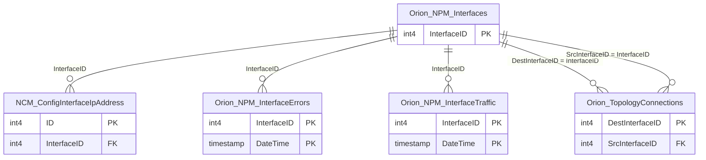
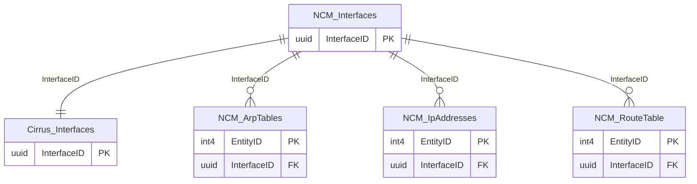
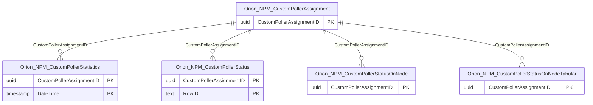

# sw_raw relationships (ERD)

Generated by `swcollect erd` from the relationships proven against SolarWinds (instance `demo/127.0.0.1:17776`). Do not edit: run it again.

sw_raw has no foreign keys between its tables on purpose: a raw row is never refused because its parent is missing. These are the connections swcollect proved instead. Every join also matches `instance_id`.

125 joins between 112 entities. Full list with ready SQL: [raw-joins.csv](raw-joins.csv). Interactive version: [raw-model.html](raw-model.html).

## Around Orion.Nodes

```mermaid
erDiagram
    Orion_Nodes ||--o{ Cirrus_NCMNodeLicenseStatus : "NodeID"
    Orion_Nodes ||--o{ NCM_Nodes : "CoreNodeID = NodeID"
    Orion_Nodes ||--o{ Orion_AlertObjects : "RelatedNodeId = NodeID"
    Orion_Nodes ||--o{ Orion_CPULoad : "NodeID"
    Orion_Nodes ||--o{ Orion_HardwareHealth_HardwareInfo : "NodeID"
    Orion_Nodes ||--o{ Orion_HardwareHealth_HardwareItem : "NodeID"
    Orion_Nodes ||--o{ Orion_NPM_CustomPollerAssignment : "NodeID"
    Orion_Nodes ||--o{ Orion_NPM_CustomPollerStatusOnNode : "NodeID"
    Orion_Nodes ||--o{ Orion_NPM_CustomPollerStatusOnNodeTabular : "NodeID"
    Orion_Nodes ||--o{ Orion_NPM_InterfaceErrors : "NodeID"
    Orion_Nodes ||--o{ Orion_NPM_InterfaceTraffic : "NodeID"
    Orion_Nodes ||--o{ Orion_NPM_Interfaces : "NodeID"
    Orion_Nodes ||--o{ Orion_NPM_InterfacesRelationship : "NodeID"
    Orion_Nodes ||--o{ Orion_NodeCdpEntry : "NodeID"
    Orion_Nodes ||--o{ Orion_NodeIPAddresses : "NodeID"
    Orion_Nodes ||--o{ Orion_NodeL2Connections : "NodeID"
    Orion_Nodes ||--o{ Orion_NodeL3Entries : "NodeID"
    Orion_Nodes ||--o{ Orion_NodeL3RoutingData : "NodeID"
    Orion_Nodes ||--o{ Orion_NodeLldpEntry : "NodeID"
    Orion_Nodes ||--o{ Orion_NodeMACAddresses : "NodeID"
    Orion_Nodes ||--o{ Orion_NodeSettings : "NodeID"
    Orion_Nodes ||--o{ Orion_NodeVlans : "NodeID"
    Orion_Nodes ||--|| Orion_NodesCustomProperties : "NodeID"
    Orion_Nodes ||--o{ Orion_OLM_LogEntry : "NodeID"
    Orion_Nodes ||--o{ Orion_OLM_MessageSources : "NodeID"
    Orion_Nodes ||--o{ Orion_ResponseTime : "NodeID"
    Orion_Nodes ||--o{ Orion_Routing_DefaultRouteChange : "NodeID"
    Orion_Nodes ||--o{ Orion_Routing_Neighbors : "NodeID"
    Orion_Nodes ||--o{ Orion_Routing_NeighborsFlapCount : "NodeID"
    Orion_Nodes ||--o{ Orion_Routing_Router : "NodeID"
    Orion_Nodes ||--o{ Orion_Routing_RoutingTable : "NodeID"
    Orion_Nodes ||--o{ Orion_Routing_RoutingTableFlap : "NodeId = NodeID"
    Orion_Nodes ||--o{ Orion_Routing_VRF : "NodeID"
    Orion_Nodes ||--o{ Orion_Routing_VRFInterface : "NodeID"
    Orion_Nodes ||--o{ Orion_STPRecords : "NodeID"
    Orion_Nodes ||--o{ Orion_TopologyConnections : "DestNodeID = NodeID"
    Orion_Nodes ||--o{ Orion_TopologyConnections : "SrcNodeID = NodeID"
    Cirrus_NCMNodeLicenseStatus {
        int4 NodeID PK
    }
    NCM_Nodes {
        uuid NodeID PK
        int4 CoreNodeID FK
    }
    Orion_AlertObjects {
        int4 AlertObjectID PK
        int4 RelatedNodeId FK
    }
    Orion_CPULoad {
        int4 NodeID PK
        timestamp DateTime PK
    }
    Orion_HardwareHealth_HardwareInfo {
        int4 ID PK
        int4 NodeID FK
    }
    Orion_HardwareHealth_HardwareItem {
        int4 ID PK
        int4 NodeID FK
    }
    Orion_NPM_CustomPollerAssignment {
        uuid CustomPollerAssignmentID PK
        int4 NodeID FK
    }
    Orion_NPM_CustomPollerStatusOnNode {
        uuid CustomPollerAssignmentID PK
        int4 NodeID FK
    }
    Orion_NPM_CustomPollerStatusOnNodeTabular {
        uuid CustomPollerAssignmentID PK
        int4 NodeID FK
    }
    Orion_NPM_InterfaceErrors {
        int4 InterfaceID PK
        timestamp DateTime PK
        int4 NodeID FK
    }
    Orion_NPM_InterfaceTraffic {
        int4 InterfaceID PK
        timestamp DateTime PK
        int4 NodeID FK
    }
    Orion_NPM_Interfaces {
        int4 InterfaceID PK
        int4 NodeID FK
    }
    Orion_NPM_InterfacesRelationship {
        int4 ChildInterfaceIndex PK
        int4 NodeID PK
    }
    Orion_NodeCdpEntry {
        text DeviceId PK
        int4 NodeID PK
    }
    Orion_NodeIPAddresses {
        text IPAddress PK
        int4 NodeID PK
    }
    Orion_NodeL2Connections {
        int4 NodeID PK
        int4 PortID PK
    }
    Orion_NodeL3Entries {
        int4 NodeID FK
    }
    Orion_NodeL3RoutingData {
        int4 NodeID FK
    }
    Orion_NodeLldpEntry {
        int4 NodeID PK
        text RemoteChassisId PK
    }
    Orion_NodeMACAddresses {
        int4 NodeID FK
    }
    Orion_NodeSettings {
        int4 NodeSettingID PK
        int4 NodeID FK
    }
    Orion_NodeVlans {
        int4 NodeID PK
        int4 VlanId PK
    }
    Orion_Nodes {
        int4 NodeID PK
    }
    Orion_NodesCustomProperties {
        int4 NodeID PK
    }
    Orion_OLM_LogEntry {
        unknown LogEntryID PK
        unknown NodeID FK
    }
    Orion_OLM_MessageSources {
        int4 MessageSourceID PK
        int4 NodeID FK
    }
    Orion_ResponseTime {
        int4 NodeID PK
        timestamp DateTime PK
    }
    Orion_Routing_DefaultRouteChange {
        int4 ChangeID PK
        int4 NodeID FK
    }
    Orion_Routing_Neighbors {
        int4 NeighborID PK
        int4 NodeID FK
    }
    Orion_Routing_NeighborsFlapCount {
        int4 NodeID FK
    }
    Orion_Routing_Router {
        int4 NodeID PK
    }
    Orion_Routing_RoutingTable {
        int8 RouteID PK
        int4 NodeID FK
    }
    Orion_Routing_RoutingTableFlap {
        int4 FlapId PK
        int4 NodeId FK
    }
    Orion_Routing_VRF {
        int4 NodeID PK
        int4 VrfIndex PK
    }
    Orion_Routing_VRFInterface {
        int4 NodeID FK
    }
    Orion_STPRecords {
        text BridgeID PK
        int4 NodeID FK
    }
    Orion_TopologyConnections {
        int4 DestInterfaceID PK
        int4 SrcNodeID FK
        int4 DestNodeID FK
    }
```

## Around NCM.Nodes

```mermaid
erDiagram
    NCM_Nodes ||--|| Cirrus_Nodes : "NodeID"
    NCM_Nodes ||--o{ NCM_ArpTables : "NodeID"
    NCM_Nodes ||--o{ NCM_BaselineNodeMap : "NodeId = NodeID"
    NCM_Nodes ||--o{ NCM_BaselineViolations : "NodeId = NodeID"
    NCM_Nodes ||--o{ NCM_BridgePorts : "NodeID"
    NCM_Nodes ||--o{ NCM_CiscoBootloadImages : "NodeID"
    NCM_Nodes ||--o{ NCM_CiscoCards : "NodeID"
    NCM_Nodes ||--o{ NCM_CiscoCdp : "NodeID"
    NCM_Nodes ||--o{ NCM_CiscoChassis : "NodeID"
    NCM_Nodes ||--o{ NCM_CiscoFlash : "NodeID"
    NCM_Nodes ||--o{ NCM_CiscoFlashFiles : "NodeID"
    NCM_Nodes ||--o{ NCM_CiscoFruFanTrayStatus : "NodeID"
    NCM_Nodes ||--o{ NCM_CiscoFruPowerStatus : "NodeID"
    NCM_Nodes ||--o{ NCM_CiscoFruPowerSupplyGroups : "NodeID"
    NCM_Nodes ||--o{ NCM_CiscoImageMIB : "NodeID"
    NCM_Nodes ||--o{ NCM_CiscoMemoryPools : "NodeID"
    NCM_Nodes ||--o{ NCM_ConfigArchive : "NodeID"
    NCM_Nodes ||--o{ NCM_ConfigBackupStatistic : "NodeID"
    NCM_Nodes ||--o{ NCM_ConfigBackupStatus : "NodeID"
    NCM_Nodes ||--o{ NCM_EntityLogical : "NodeID"
    NCM_Nodes ||--o{ NCM_EntityPhysical : "NodeID"
    NCM_Nodes ||--o{ NCM_EntityPhysicalJuniper : "NodeID"
    NCM_Nodes ||--o{ NCM_Interfaces : "NodeID"
    NCM_Nodes ||--o{ NCM_InventoryStatistic : "NodeID"
    NCM_Nodes ||--o{ NCM_IpAddresses : "NodeID"
    NCM_Nodes ||--o{ NCM_LatestTransferJobStatus : "NodeID"
    NCM_Nodes ||--o{ NCM_MacForwarding : "NodeID"
    NCM_Nodes ||--o{ NCM_NodeProperties : "NodeID"
    NCM_Nodes ||--o{ NCM_PortsTcp : "NodeID"
    NCM_Nodes ||--o{ NCM_PortsUdp : "NodeID"
    NCM_Nodes ||--o{ NCM_RTNAudit : "NodeID"
    NCM_Nodes ||--o{ NCM_RouteTable : "NodeID"
    NCM_Nodes ||--o{ NCM_TransferResults : "NodeID"
    NCM_Nodes ||--o{ NCM_VLANs : "NodeID"
    Cirrus_Nodes {
        uuid NodeID PK
    }
    NCM_ArpTables {
        int4 EntityID PK
        uuid NodeID FK
    }
    NCM_BaselineNodeMap {
        uuid NodeId PK
    }
    NCM_BaselineViolations {
        uuid ConfigID PK
        uuid NodeId FK
    }
    NCM_BridgePorts {
        int4 EntityID PK
        uuid NodeID FK
    }
    NCM_CiscoBootloadImages {
        int4 EntityID PK
        uuid NodeID FK
    }
    NCM_CiscoCards {
        int4 EntityID PK
        uuid NodeID FK
    }
    NCM_CiscoCdp {
        int4 EntityID PK
        uuid NodeID FK
    }
    NCM_CiscoChassis {
        text ChassisID PK
        uuid NodeID FK
    }
    NCM_CiscoFlash {
        int4 EntityID PK
        uuid NodeID FK
    }
    NCM_CiscoFlashFiles {
        int4 EntityID PK
        uuid NodeID FK
    }
    NCM_CiscoFruFanTrayStatus {
        int4 EntityID PK
        uuid NodeID FK
    }
    NCM_CiscoFruPowerStatus {
        int4 EntityID PK
        uuid NodeID FK
    }
    NCM_CiscoFruPowerSupplyGroups {
        int4 EntityID PK
        uuid NodeID FK
    }
    NCM_CiscoImageMIB {
        int4 EntityID PK
        uuid NodeID FK
    }
    NCM_CiscoMemoryPools {
        int4 EntityID PK
        uuid NodeID FK
    }
    NCM_ConfigArchive {
        uuid ConfigID PK
        uuid NodeID FK
    }
    NCM_ConfigBackupStatistic {
        uuid NodeID PK
    }
    NCM_ConfigBackupStatus {
        int4 CoreNodeID PK
        uuid NodeID FK
    }
    NCM_EntityLogical {
        int4 EntityID PK
        uuid NodeID FK
    }
    NCM_EntityPhysical {
        int4 EntPhysicalIndex PK
        uuid NodeID FK
    }
    NCM_EntityPhysicalJuniper {
        int4 JnxContainersIndex PK
        text JnxContentsChassisId PK
        uuid NodeID FK
    }
    NCM_Interfaces {
        uuid InterfaceID PK
        uuid NodeID FK
    }
    NCM_InventoryStatistic {
        uuid NodeID PK
    }
    NCM_IpAddresses {
        int4 EntityID PK
        uuid NodeID FK
    }
    NCM_LatestTransferJobStatus {
        int4 JobId PK
        uuid NodeID FK
    }
    NCM_MacForwarding {
        int4 EntityID PK
        uuid NodeID FK
    }
    NCM_NodeProperties {
        int4 CoreNodeID PK
        uuid NodeID FK
    }
    NCM_Nodes {
        uuid NodeID PK
    }
    NCM_PortsTcp {
        int4 EntityID PK
        uuid NodeID FK
    }
    NCM_PortsUdp {
        int4 EntityID PK
        uuid NodeID FK
    }
    NCM_RTNAudit {
        uuid ID PK
        uuid NodeID FK
    }
    NCM_RouteTable {
        int4 EntityID PK
        uuid NodeID FK
    }
    NCM_TransferResults {
        uuid TransferID PK
        uuid NodeID FK
    }
    NCM_VLANs {
        int4 VLANID PK
        uuid NodeID FK
    }
```

## Around Cirrus.Nodes

```mermaid
erDiagram
    Cirrus_Nodes ||--o{ Cirrus_ArpTables : "NodeID"
    Cirrus_Nodes ||--o{ Cirrus_BridgePorts : "NodeID"
    Cirrus_Nodes ||--o{ Cirrus_CacheDiffResults : "NodeID"
    Cirrus_Nodes ||--o{ Cirrus_CiscoCards : "NodeID"
    Cirrus_Nodes ||--o{ Cirrus_CiscoCdp : "NodeID"
    Cirrus_Nodes ||--o{ Cirrus_CiscoChassis : "NodeID"
    Cirrus_Nodes ||--o{ Cirrus_CiscoFlash : "NodeID"
    Cirrus_Nodes ||--o{ Cirrus_CiscoFlashFiles : "NodeID"
    Cirrus_Nodes ||--o{ Cirrus_CiscoImageMIB : "NodeID"
    Cirrus_Nodes ||--o{ Cirrus_CiscoMemoryPools : "NodeID"
    Cirrus_Nodes ||--o{ Cirrus_ConfigArchive : "NodeID"
    Cirrus_Nodes ||--o{ Cirrus_EntityLogical : "NodeID"
    Cirrus_Nodes ||--o{ Cirrus_EntityPhysical : "NodeID"
    Cirrus_Nodes ||--o{ Cirrus_Interfaces : "NodeID"
    Cirrus_Nodes ||--o{ Cirrus_IpAddresses : "NodeID"
    Cirrus_Nodes ||--o{ Cirrus_LatestComparisonResults : "NodeID"
    Cirrus_Nodes ||--o{ Cirrus_MacForwarding : "NodeID"
    Cirrus_Nodes ||--o{ Cirrus_NCM_EosMatchQueue : "NodeID"
    Cirrus_Nodes ||--o{ Cirrus_NodeProperties : "NodeID"
    Cirrus_Nodes ||--o{ Cirrus_PolicyCacheResults : "NodeID"
    Cirrus_Nodes ||--o{ Cirrus_PortsTcp : "NodeID"
    Cirrus_Nodes ||--o{ Cirrus_PortsUdp : "NodeID"
    Cirrus_Nodes ||--o{ Cirrus_RouteTable : "NodeID"
    Cirrus_Nodes ||--o{ Cirrus_VLANs : "NodeID"
    Cirrus_ArpTables {
        uuid InterfaceID PK
        uuid NodeID FK
    }
    Cirrus_BridgePorts {
        int4 InterfaceIndex PK
        uuid NodeID PK
    }
    Cirrus_CacheDiffResults {
        uuid ConfigID PK
        uuid NodeID FK
    }
    Cirrus_CiscoCards {
        int4 CardIndex PK
        uuid NodeID PK
    }
    Cirrus_CiscoCdp {
        text CDPIndex PK
        uuid NodeID PK
    }
    Cirrus_CiscoChassis {
        text ChassisID PK
        uuid NodeID FK
    }
    Cirrus_CiscoFlash {
        uuid NodeID FK
    }
    Cirrus_CiscoFlashFiles {
        uuid NodeID FK
    }
    Cirrus_CiscoImageMIB {
        int4 ImageIndex PK
        uuid NodeID PK
    }
    Cirrus_CiscoMemoryPools {
        uuid NodeID FK
    }
    Cirrus_ConfigArchive {
        uuid BaseConfigID PK
        uuid NodeID FK
    }
    Cirrus_EntityLogical {
        uuid NodeID PK
    }
    Cirrus_EntityPhysical {
        uuid NodeID FK
    }
    Cirrus_Interfaces {
        uuid InterfaceID PK
        uuid NodeID FK
    }
    Cirrus_IpAddresses {
        uuid NodeID FK
    }
    Cirrus_LatestComparisonResults {
        uuid NodeID PK
    }
    Cirrus_MacForwarding {
        uuid NodeID FK
    }
    Cirrus_NCM_EosMatchQueue {
        int4 ID PK
        uuid NodeID FK
    }
    Cirrus_NodeProperties {
        int4 CoreNodeID PK
        uuid NodeID FK
    }
    Cirrus_Nodes {
        uuid NodeID PK
    }
    Cirrus_PolicyCacheResults {
        uuid NodeID PK
        uuid RuleID PK
    }
    Cirrus_PortsTcp {
        uuid NodeID FK
    }
    Cirrus_PortsUdp {
        uuid NodeID FK
    }
    Cirrus_RouteTable {
        uuid NodeID FK
    }
    Cirrus_VLANs {
        int4 VLANID PK
        uuid NodeID FK
    }
```

## Around Orion.NPM.Interfaces

## Around NCM.Interfaces

## Around Orion.NPM.CustomPollerAssignment

## Smaller groups

```mermaid
erDiagram
    Cirrus_Interfaces ||--o{ Cirrus_ArpTables : "InterfaceID"
    Cirrus_Interfaces ||--o{ Cirrus_IpAddresses : "InterfaceID"
    Cirrus_Interfaces ||--o{ Cirrus_RouteTable : "InterfaceID"
    Orion_AlertObjects ||--o{ Orion_AlertActive : "AlertObjectID"
    Orion_AlertObjects ||--o{ Orion_AlertHistory : "AlertObjectID"
    Orion_NPM_CustomPollers ||--o{ Orion_NPM_CustomPollerAssignment : "CustomPollerID"
    Orion_NPM_CustomPollers ||--o{ Orion_NPM_CustomPollerStatusOnNode : "CustomPollerID"
    Cirrus_PolicyReports ||--o{ Cirrus_PolicyAssignment : "PolicyReportID"
    Cirrus_PolicyRules ||--o{ Cirrus_PolicyRuleAssignment : "PolicyRuleID"
    IPAM_IPNode ||--o{ IPAM_IPConflict : "IPNodeId = IpNodeId"
    IPAM_Subnet ||--o{ IPAM_IPNode : "SubnetId"
    NCM_VLANs ||--|| Cirrus_VLANs : "VLANID"
    Orion_Accounts ||--o{ IPAM_IPConflict : "AccountID"
    Orion_OLM_LogEntry ||--o{ Orion_OLM_LogEntryFieldValue : "LogEntryID"
    Orion_OLM_LogEntryLevel ||--o{ Orion_OLM_LogEntry : "LogEntryLevelID"
    Orion_OLM_LogEntryType ||--o{ Orion_OLM_LogEntry : "LogEntryTypeID"
    Orion_OLM_MessageSources ||--o{ Orion_OLM_LogEntry : "MessageSourceID"
    Cirrus_ArpTables {
        uuid InterfaceID PK
    }
    Cirrus_Interfaces {
        uuid InterfaceID PK
    }
    Cirrus_IpAddresses {
        uuid InterfaceID FK
    }
    Cirrus_PolicyAssignment {
        uuid PolicyReportID PK
    }
    Cirrus_PolicyReports {
        uuid PolicyReportID PK
    }
    Cirrus_PolicyRuleAssignment {
        uuid PolicyRuleID PK
    }
    Cirrus_PolicyRules {
        uuid PolicyRuleID PK
    }
    Cirrus_RouteTable {
        uuid InterfaceID FK
    }
    Cirrus_VLANs {
        int4 VLANID PK
    }
    IPAM_IPConflict {
        int4 IPConflictId PK
        text AccountID FK
        int8 IPNodeId FK
    }
    IPAM_IPNode {
        int8 IpNodeId PK
        int4 SubnetId FK
    }
    IPAM_Subnet {
        int4 SubnetId PK
    }
    NCM_VLANs {
        int4 VLANID PK
    }
    Orion_Accounts {
        text AccountID PK
    }
    Orion_AlertActive {
        int8 AlertActiveID PK
        int4 AlertObjectID FK
    }
    Orion_AlertHistory {
        unknown AlertHistoryID PK
        unknown AlertObjectID FK
    }
    Orion_AlertObjects {
        int4 AlertObjectID PK
    }
    Orion_NPM_CustomPollerAssignment {
        uuid CustomPollerAssignmentID PK
        uuid CustomPollerID FK
    }
    Orion_NPM_CustomPollerStatusOnNode {
        uuid CustomPollerAssignmentID PK
        uuid CustomPollerID FK
    }
    Orion_NPM_CustomPollers {
        uuid CustomPollerID PK
    }
    Orion_OLM_LogEntry {
        unknown LogEntryID PK
        unknown LogEntryLevelID FK
        unknown MessageSourceID FK
        unknown LogEntryTypeID FK
    }
    Orion_OLM_LogEntryFieldValue {
        int8 LogEntryFieldValueID PK
        int8 LogEntryID FK
    }
    Orion_OLM_LogEntryLevel {
        int4 LogEntryLevelID PK
    }
    Orion_OLM_LogEntryType {
        int4 LogEntryTypeID PK
    }
    Orion_OLM_MessageSources {
        int4 MessageSourceID PK
    }
```

## Where each entity is stored

| Entity | Table | Key | Fields | Rows |
|---|---|---|---|---|
| `Cirrus.ArpTables` | `sw_raw.cirrus_arptables` | InterfaceID | 16 | 144 |
| `Cirrus.BridgePorts` | `sw_raw.cirrus_bridgeports` | InterfaceIndex, NodeID | 16 | 84 |
| `Cirrus.CacheDiffResults` | `sw_raw.cirrus_cachediffresults` | ConfigID | 18 | 36 |
| `Cirrus.CiscoCards` | `sw_raw.cirrus_ciscocards` | CardIndex, NodeID | 20 | 54 |
| `Cirrus.CiscoCdp` | `sw_raw.cirrus_ciscocdp` | CDPIndex, NodeID | 19 | 12 |
| `Cirrus.CiscoChassis` | `sw_raw.cirrus_ciscochassis` | ChassisID | 23 | 18 |
| `Cirrus.CiscoFlash` | `sw_raw.cirrus_ciscoflash` | row hash | 18 | 36 |
| `Cirrus.CiscoFlashFiles` | `sw_raw.cirrus_ciscoflashfiles` | row hash | 13 | 36 |
| `Cirrus.CiscoImageMIB` | `sw_raw.cirrus_ciscoimagemib` | ImageIndex, NodeID | 12 | 72 |
| `Cirrus.CiscoMemoryPools` | `sw_raw.cirrus_ciscomemorypools` | row hash | 13 | 36 |
| `Cirrus.ConfigArchive` | `sw_raw.cirrus_configarchive` | BaseConfigID | 19 | 144 |
| `Cirrus.EntityLogical` | `sw_raw.cirrus_entitylogical` | NodeID | 14 | 36 |
| `Cirrus.EntityPhysical` | `sw_raw.cirrus_entityphysical` | row hash | 23 | 216 |
| `Cirrus.Interfaces` | `sw_raw.cirrus_interfaces` | InterfaceID | 25 | 356 |
| `Cirrus.IpAddresses` | `sw_raw.cirrus_ipaddresses` | row hash | 18 | 182 |
| `Cirrus.LatestComparisonResults` | `sw_raw.cirrus_latestcomparisonresults` | NodeID | 9 | 36 |
| `Cirrus.MacForwarding` | `sw_raw.cirrus_macforwarding` | row hash | 12 | 70 |
| `Cirrus.NCMNodeLicenseStatus` | `sw_raw.cirrus_ncmnodelicensestatus` | NodeID | 7 | 36 |
| `Cirrus.NCM_EosMatchQueue` | `sw_raw.cirrus_ncm_eosmatchqueue` | ID | 19 | 26 |
| `Cirrus.NodeProperties` | `sw_raw.cirrus_nodeproperties` | CoreNodeID | 45 | 36 |
| `Cirrus.Nodes` | `sw_raw.cirrus_nodes` | NodeID | 71 | 36 |
| `Cirrus.PolicyAssignment` | `sw_raw.cirrus_policyassignment` | PolicyReportID | 7 | 2 |
| `Cirrus.PolicyCacheResults` | `sw_raw.cirrus_policycacheresults` | NodeID, RuleID | 23 | 10 |
| `Cirrus.PolicyReports` | `sw_raw.cirrus_policyreports` | PolicyReportID | 16 | 2 |
| `Cirrus.PolicyRuleAssignment` | `sw_raw.cirrus_policyruleassignment` | PolicyRuleID | 7 | 3 |
| `Cirrus.PolicyRules` | `sw_raw.cirrus_policyrules` | PolicyRuleID | 20 | 3 |
| `Cirrus.PortsTcp` | `sw_raw.cirrus_portstcp` | row hash | 16 | 116 |
| `Cirrus.PortsUdp` | `sw_raw.cirrus_portsudp` | row hash | 12 | 144 |
| `Cirrus.RouteTable` | `sw_raw.cirrus_routetable` | row hash | 23 | 1200 |
| `Cirrus.VLANs` | `sw_raw.cirrus_vlans` | VLANID | 14 | 42 |
| `IPAM.IPConflict` | `sw_raw.ipam_ipconflict` | IPConflictId | 17 | 1 |
| `IPAM.IPNode` | `sw_raw.ipam_ipnode` | IpNodeId | 38 | 190 |
| `IPAM.Subnet` | `sw_raw.ipam_subnet` | SubnetId | 38 | 7 |
| `NCM.ArpTables` | `sw_raw.ncm_arptables` | EntityID | 17 | 144 |
| `NCM.BaselineNodeMap` | `sw_raw.ncm_baselinenodemap` | NodeId | 9 | 26 |
| `NCM.BaselineViolations` | `sw_raw.ncm_baselineviolations` | ConfigID | 10 | 26 |
| `NCM.BridgePorts` | `sw_raw.ncm_bridgeports` | EntityID | 17 | 84 |
| `NCM.CiscoBootloadImages` | `sw_raw.ncm_ciscobootloadimages` | EntityID | 13 | 18 |
| `NCM.CiscoCards` | `sw_raw.ncm_ciscocards` | EntityID | 21 | 54 |
| `NCM.CiscoCdp` | `sw_raw.ncm_ciscocdp` | EntityID | 20 | 12 |
| `NCM.CiscoChassis` | `sw_raw.ncm_ciscochassis` | ChassisID | 24 | 18 |
| `NCM.CiscoFlash` | `sw_raw.ncm_ciscoflash` | EntityID | 20 | 36 |
| `NCM.CiscoFlashFiles` | `sw_raw.ncm_ciscoflashfiles` | EntityID | 14 | 36 |
| `NCM.CiscoFruFanTrayStatus` | `sw_raw.ncm_ciscofrufantraystatus` | EntityID | 12 | 36 |
| `NCM.CiscoFruPowerStatus` | `sw_raw.ncm_ciscofrupowerstatus` | EntityID | 13 | 36 |
| `NCM.CiscoFruPowerSupplyGroups` | `sw_raw.ncm_ciscofrupowersupplygroups` | EntityID | 16 | 18 |
| `NCM.CiscoImageMIB` | `sw_raw.ncm_ciscoimagemib` | EntityID | 13 | 72 |
| `NCM.CiscoMemoryPools` | `sw_raw.ncm_ciscomemorypools` | EntityID | 14 | 36 |
| `NCM.ConfigArchive` | `sw_raw.ncm_configarchive` | ConfigID | 22 | 144 |
| `NCM.ConfigBackupStatistic` | `sw_raw.ncm_configbackupstatistic` | NodeID | 9 | 36 |
| `NCM.ConfigBackupStatus` | `sw_raw.ncm_configbackupstatus` | CoreNodeID | 13 | 36 |
| `NCM.ConfigInterfaceIpAddress` | `sw_raw.ncm_configinterfaceipaddress` | ID | 8 | 36 |
| `NCM.EntityLogical` | `sw_raw.ncm_entitylogical` | EntityID | 15 | 36 |
| `NCM.EntityPhysical` | `sw_raw.ncm_entityphysical` | EntPhysicalIndex | 26 | 216 |
| `NCM.EntityPhysicalJuniper` | `sw_raw.ncm_entityphysicaljuniper` | JnxContainersIndex, JnxContentsChassisId | 17 | 40 |
| `NCM.Interfaces` | `sw_raw.ncm_interfaces` | InterfaceID | 29 | 356 |
| `NCM.InventoryStatistic` | `sw_raw.ncm_inventorystatistic` | NodeID | 7 | 36 |
| `NCM.IpAddresses` | `sw_raw.ncm_ipaddresses` | EntityID | 19 | 182 |
| `NCM.LatestTransferJobStatus` | `sw_raw.ncm_latesttransferjobstatus` | JobId | 10 | 12 |
| `NCM.MacForwarding` | `sw_raw.ncm_macforwarding` | EntityID | 13 | 70 |
| `NCM.NodeProperties` | `sw_raw.ncm_nodeproperties` | CoreNodeID | 36 | 36 |
| `NCM.Nodes` | `sw_raw.ncm_nodes` | NodeID | 53 | 36 |
| `NCM.PortsTcp` | `sw_raw.ncm_portstcp` | EntityID | 17 | 116 |
| `NCM.PortsUdp` | `sw_raw.ncm_portsudp` | EntityID | 13 | 144 |
| `NCM.RTNAudit` | `sw_raw.ncm_rtnaudit` | ID | 11 | 18 |
| `NCM.RouteTable` | `sw_raw.ncm_routetable` | EntityID | 24 | 1200 |
| `NCM.TransferResults` | `sw_raw.ncm_transferresults` | TransferID | 21 | 12 |
| `NCM.VLANs` | `sw_raw.ncm_vlans` | VLANID | 15 | 42 |
| `Orion.Accounts` | `sw_raw.orion_accounts` | AccountID | 44 | 2 |
| `Orion.AlertActive` | `sw_raw.orion_alertactive` | AlertActiveID | 16 | 4 |
| `Orion.AlertHistory` | `Loki (event source, no table)` | AlertHistoryID |  |  |
| `Orion.AlertObjects` | `sw_raw.orion_alertobjects` | AlertObjectID | 23 | 14 |
| `Orion.CPULoad` | `sw_ts.orion_cpuload` | NodeID, DateTime | 20 | 0 |
| `Orion.HardwareHealth.HardwareInfo` | `sw_raw.orion_hardwarehealth_hardwareinfo` | ID | 42 | 26 |
| `Orion.HardwareHealth.HardwareItem` | `sw_raw.orion_hardwarehealth_hardwareitem` | ID | 35 | 104 |
| `Orion.NPM.CustomPollerAssignment` | `sw_raw.orion_npm_custompollerassignment` | CustomPollerAssignmentID | 29 | 12 |
| `Orion.NPM.CustomPollerStatistics` | `sw_ts.orion_npm_custompollerstatistics` | CustomPollerAssignmentID, DateTime | 17 | 0 |
| `Orion.NPM.CustomPollerStatus` | `sw_raw.orion_npm_custompollerstatus` | CustomPollerAssignmentID, RowID | 12 | 48 |
| `Orion.NPM.CustomPollerStatusOnNode` | `sw_raw.orion_npm_custompollerstatusonnode` | CustomPollerAssignmentID | 17 | 12 |
| `Orion.NPM.CustomPollerStatusOnNodeTabular` | `sw_raw.orion_npm_custompollerstatusonnodetabular` | CustomPollerAssignmentID | 19 | 12 |
| `Orion.NPM.CustomPollers` | `sw_raw.orion_npm_custompollers` | CustomPollerID | 24 | 3 |
| `Orion.NPM.InterfaceErrors` | `sw_ts.orion_npm_interfaceerrors` | InterfaceID, DateTime | 24 | 0 |
| `Orion.NPM.InterfaceTraffic` | `sw_ts.orion_npm_interfacetraffic` | InterfaceID, DateTime | 40 | 0 |
| `Orion.NPM.Interfaces` | `sw_raw.orion_npm_interfaces` | InterfaceID | 105 | 372 |
| `Orion.NPM.InterfacesRelationship` | `sw_raw.orion_npm_interfacesrelationship` | ChildInterfaceIndex, NodeID | 11 | 24 |
| `Orion.NodeCdpEntry` | `sw_raw.orion_nodecdpentry` | DeviceId, NodeID | 12 | 12 |
| `Orion.NodeIPAddresses` | `sw_raw.orion_nodeipaddresses` | IPAddress, NodeID | 11 | 191 |
| `Orion.NodeL2Connections` | `sw_raw.orion_nodel2connections` | NodeID, PortID | 10 | 70 |
| `Orion.NodeL3Entries` | `sw_raw.orion_nodel3entries` | row hash | 10 | 70 |
| `Orion.NodeL3RoutingData` | `sw_raw.orion_nodel3routingdata` | row hash | 11 | 150 |
| `Orion.NodeLldpEntry` | `sw_raw.orion_nodelldpentry` | NodeID, RemoteChassisId | 13 | 148 |
| `Orion.NodeMACAddresses` | `sw_raw.orion_nodemacaddresses` | row hash | 8 | 360 |
| `Orion.NodeSettings` | `sw_raw.orion_nodesettings` | NodeSettingID | 9 | 76 |
| `Orion.NodeVlans` | `sw_raw.orion_nodevlans` | NodeID, VlanId | 13 | 42 |
| `Orion.Nodes` | `sw_raw.orion_nodes` | NodeID | 113 | 40 |
| `Orion.NodesCustomProperties` | `sw_raw.orion_nodescustomproperties` | NodeID | 10 | 40 |
| `Orion.OLM.LogEntry` | `Loki (event source, no table)` | LogEntryID |  |  |
| `Orion.OLM.LogEntryFieldValue` | `sw_raw.orion_olm_logentryfieldvalue` | LogEntryFieldValueID | 12 | 800 |
| `Orion.OLM.LogEntryLevel` | `sw_raw.orion_olm_logentrylevel` | LogEntryLevelID | 8 | 4 |
| `Orion.OLM.LogEntryType` | `sw_raw.orion_olm_logentrytype` | LogEntryTypeID | 10 | 2 |
| `Orion.OLM.MessageSources` | `sw_raw.orion_olm_messagesources` | MessageSourceID | 14 | 40 |
| `Orion.ResponseTime` | `sw_ts.orion_responsetime` | NodeID, DateTime | 17 | 0 |
| `Orion.Routing.DefaultRouteChange` | `sw_raw.orion_routing_defaultroutechange` | ChangeID | 13 | 20 |
| `Orion.Routing.Neighbors` | `sw_raw.orion_routing_neighbors` | NeighborID | 31 | 165 |
| `Orion.Routing.NeighborsFlapCount` | `sw_raw.orion_routing_neighborsflapcount` | row hash | 11 | 495 |
| `Orion.Routing.Router` | `sw_raw.orion_routing_router` | NodeID | 7 | 38 |
| `Orion.Routing.RoutingTable` | `sw_raw.orion_routing_routingtable` | RouteID | 32 | 1200 |
| `Orion.Routing.RoutingTableFlap` | `sw_raw.orion_routing_routingtableflap` | FlapId | 16 | 6 |
| `Orion.Routing.VRF` | `sw_raw.orion_routing_vrf` | NodeID, VrfIndex | 12 | 24 |
| `Orion.Routing.VRFInterface` | `sw_raw.orion_routing_vrfinterface` | row hash | 10 | 48 |
| `Orion.STPRecords` | `sw_raw.orion_stprecords` | BridgeID | 13 | 14 |
| `Orion.TopologyConnections` | `sw_raw.orion_topologyconnections` | DestInterfaceID | 17 | 149 |
